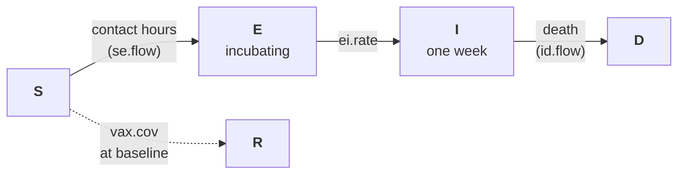

# Rabies on an Observed Raccoon Contact Network

## Description

A zoonotic pathogen simulated over an empirical wildlife network. Reynolds et al. (2015) fitted proximity-logging collars to raccoons in a suburban forest preserve in Illinois and recorded every close contact for a year; the data deposited with the paper are 52 weekly matrices of contact time between 24 raccoons. Every animal and every contact are observed, so there is nothing to estimate: the network enters `netsim` as it is, through `netcensus()`, and the simulation reads the contacts of week `at` at time step `at`. No `netest`, no `netdx`.

The example asks the source paper's question: how much does the week of introduction matter for a rabies outbreak, and how much vaccination coverage does it take to keep one small? One infectious raccoon is introduced in one of four weeks a quarter of a year apart (summer, autumn, winter, spring) into a population with 0, 30, or 60 percent baseline oral rabies vaccination coverage, and the outcome is the number of secondary cases. Contact intensity comes from the data: the per-pair transmission probability is a constant hazard per hour of proximity, so a shared den transmits almost surely and a brief encounter rarely does.

The annotated tutorial is on the [Gallery website](https://epimodel.github.io/EpiModel-Gallery/examples/rabies-raccoon-network/).

## Model Structure

| Status | Description |
|--------|-------------|
| `s` | Susceptible |
| `e` | Exposed: infected and incubating (geometric, mean 5 weeks) |
| `i` | Infectious: clinical rabies, transmits for one week, then dies |
| `d` | Dead of rabies |
| `r` | Vaccinated, immune |

The time step is one week, the resolution of the contact data. The observed year is played twice so that a chain started late in the year can run its course; this is the one modeling assumption layered on top of the data.

### The observed network layer

`raccoon_contacts.csv` holds the weekly contact matrices in long form (week, raccoon1, raccoon2, seconds), from the Animal Social Network Repository copy of the Dryad deposit. Each dyad-week becomes an edge spell in a `networkDynamic` object, and `netcensus()` wraps that object as a layer. The layer is binary; the hours of contact per pair and week go to the infection module as a parameter.

Weeks 3 and 4 of the deposit record as many pairs as the weeks around them but less than half an hour of contact in total and no contact longer than five minutes, against more than ten hours in every other week. They are kept as deposited, and no introduction is placed in them.

Before any simulation, the page computes from the data the expected number of raccoons one infectious raccoon infects directly in each week. It runs from below one in late spring and early summer to about three in midwinter, when raccoons den together.

### Modules

- `infect`: discordant pairs from `discord_edgelist()` on the census layer, transmission with probability `1 - exp(-inf.hazard * hours)`, recorded with `set_transmat()` together with the contact hours.
- `progress`: exposed to infectious at `ei.rate` per week; infectious raccoons die at the end of their infectious week. A dead raccoon stays in the census as an inert node, since the node set of an observed network is fixed.
- `introduce`: one susceptible raccoon with a contact in `intro.week` becomes infectious.
- `vaccinate`: a random fraction `vax.cov` set to `r` at baseline.

## Parameters

| Parameter | Value | Meaning |
|-----------|-------|---------|
| `inf.hazard` | 2 per hour | Transmission hazard per hour of proximity; median pair 0.09, one hour 0.86, shared den 1 |
| `ei.rate` | 1/5 per week | Mean incubation of five weeks |
| `intro.week` | 6, 19, 32, 45 | Week of introduction; the breeding season is weeks 24 to 39 |
| `vax.cov` | 0, 0.3, 0.6 | Baseline vaccination coverage |

## Key Findings

The chance that an introduction causes any secondary case follows the transmission potential of its week: 94 percent for a winter introduction (week 32) against 56 percent in spring (week 45). Chains started in summer, autumn, or winter run into the winter weeks of long contacts and average about seven secondary cases when they start; chains started in spring average about four. This is the seasonal effect of the source paper, and Hirsch et al. (2016) attribute it in this population to contact duration raised by winter co-denning. For a winter introduction, 30 percent coverage cuts the probability of five or more secondary cases from 0.75 to 0.32 and 60 percent to 0.06. Sixty percent of transmissions occur over pairs with at least an hour of contact in the week, although such pairs are 16 percent of pair-weeks.

## References

- Reynolds JJH, Hirsch BT, Gehrt SD, Craft ME. Raccoon contact networks predict seasonal susceptibility to rabies outbreaks and limitations of vaccination. *Journal of Animal Ecology*. 2015;84(6):1720-1731. <https://doi.org/10.1111/1365-2656.12422>. Data: <https://doi.org/10.5061/dryad.gr40r>.
- Sah P, Méndez JD, Bansal S. A multi-species repository of social networks. *Scientific Data*. 2019;6:44. <https://doi.org/10.1038/s41597-019-0056-z>.
- Hirsch BT, Prange S, Hauver SA, Gehrt SD. Raccoon social networks and the potential for disease transmission. *PLoS ONE*. 2013;8(10):e75830. <https://doi.org/10.1371/journal.pone.0075830>.
- Hirsch BT, Reynolds JJH, Gehrt SD, Craft ME. Which mechanisms drive seasonal rabies outbreaks in raccoons? A test using dynamic social network models. *Journal of Applied Ecology*. 2016;53(3):804-813. <https://doi.org/10.1111/1365-2664.12628>.
- Elmore SA, Chipman RB, Slate D, Huyvaert KP, VerCauteren KC, Gilbert AT. Management and modeling approaches for controlling raccoon rabies: The road to elimination. *PLoS Neglected Tropical Diseases*. 2017;11(3):e0005249. <https://doi.org/10.1371/journal.pntd.0005249>.
- Farine DR, Whitehead H. Constructing, conducting and interpreting animal social network analysis. *Journal of Animal Ecology*. 2015;84(5):1144-1163. <https://doi.org/10.1111/1365-2656.12418>.
- Webber QMR, Brigham RM, Park AD, Gillam EH, O'Shea TJ, Willis CKR. Social network characteristics and predicted pathogen transmission in summer colonies of female big brown bats (*Eptesicus fuscus*). *Behavioral Ecology and Sociobiology*. 2016;70(5):701-712. <https://doi.org/10.1007/s00265-016-2093-3>.

The rabies parameters are illustrative choices within published ranges and are not calibrated to surveillance data.

## Author

Samuel M. Jenness, Emory University (http://samueljenness.org/)
