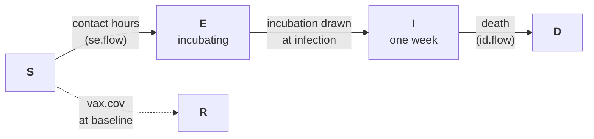

# Rabies on an Observed Raccoon Contact Network

## Description

A zoonotic pathogen simulated over an empirical wildlife network. Hirsch et al. (2013) fitted proximity-logging collars to nearly all the resident adult raccoons in a 20-ha core of a suburban forest preserve in Illinois, and Reynolds et al. (2015) deposited 52 weekly matrices of contact time among 24 of them. For those animals there is nothing to estimate: the network enters `netsim` as it is, through `netcensus()`, and the simulation reads the contacts of week `at` at time step `at`. No `netest`, no `netdx`. The layer also works with EpiModel's built-in models, and the page shows a quick SI run on it.

The record covers collared adults, not the whole population: kits were too small to collar, the core sits in a 1,499-ha preserve at 40 to 70 raccoons per km², and collars failed and were replaced through the year. The rabies introductions are hypothetical; Illinois lies west of the eastern raccoon rabies range. The example asks how much the time of year of an introduction matters and how much immunity keeps an outbreak small. Each simulation draws its introduction week, so one `netsim()` call covers the year, and the share of raccoons immune at baseline is 0, 25, 50, or 75 percent. The outcome is the number of additional cases.

The annotated tutorial is on the [Gallery website](https://epimodel.github.io/EpiModel-Gallery/examples/rabies-raccoon-network/).

## Model Structure

| Status | Description |
|--------|-------------|
| `s` | Susceptible |
| `e` | Exposed: infected and incubating (gamma, mean 6 weeks, mode 5) |
| `i` | Infectious: clinical rabies, transmits for one week, then dies |
| `d` | Dead of rabies |
| `r` | Immune at baseline (vaccinated) |

The time step is one week, the resolution of the contact data. Week 1 is in early July 2004, and the deposit marks weeks 24 to 39 as the breeding season.

### The observed network layer

`raccoon_contacts.csv` holds the weekly contact matrices in long form (week, raccoon1, raccoon2, seconds), from the Animal Social Network Repository copy of the Dryad deposit. The page separates the collars from the behavior: pairs in contact track the number of raccoons with a working collar, while contact hours per pair rise about tenfold from summer to winter, when raccoons den together.

Three data problems are documented and handled. Weeks 3 and 4 record almost no contact time (week 4 looks like a trapping or collar-servicing week) and are filled from weeks 2 and 5. Weeks 19 and 20 are identical and are kept. Three pair-weeks record a full week together.

The year is played twice so that late chains can run their course, and year two holds only the 16 raccoons still recorded at the end of year one. Each pair-week becomes an edge spell in a `networkDynamic` object, and `netcensus()` wraps that object as a layer. The layer is binary; the hours of contact per pair and week go to the infection module as a parameter.

### Modules

- `infect`: discordant pairs from `discord_edgelist()` on the census layer, transmission with probability `1 - exp(-inf.hazard * hours)`, one infector per new case, an incubation period drawn at infection, and a `set_transmat()` record with the contact hours. It stops if a census edge has no contact hours.
- `progress`: a raccoon infected in week t with incubation d is infectious in week t + d and dies at the end of it. A dead raccoon stays in the census as an inert node.
- `introduce`: draws the simulation's introduction week at its first step and stores it with `set_param()`, then makes one susceptible raccoon with a contact that week infectious.
- `vaccinate`: `round(vax.cov * 24)` raccoons set to `r` at baseline.

## Parameters

| Parameter | Value | Meaning |
|-----------|-------|---------|
| `inf.hazard` | 0.5 per hour | Transmission hazard per hour of proximity, a stand-in for bites; three minutes 0.02, one hour 0.39, a day 1 |
| `inc.mean`, `inc.shape` | 6 weeks, 6 | Gamma incubation rounded to weeks: mode 5 weeks (Tinline et al. 2002), 94% between 3 and 12 weeks |
| `intro.week` | 2 to 52 | Candidate introduction weeks; each simulation draws one |
| `vax.cov` | 0, 0.25, 0.5, 0.75 | Share of the 24 raccoons immune at baseline |

## Key Findings

The page computes from the data, before any simulation, the chance that an introduction in each week infects anyone, and the simulated chance tracks it week by week (correlation 0.95). With no immunity, introductions in winter and autumn most often spread (0.64 and 0.59), and spring introductions spread least (0.39) and produce the smallest outbreaks (0.9 additional cases on average against 1.8 to 2.6). Spring is lowest at every transmission hazard tried; which season is riskiest depends on the hazard. With 6, 12, and 18 of the 24 raccoons immune, mean additional cases fall from 1.9 to 1.1, 0.6, and 0.2. These numbers are not comparable with published thresholds (about 85% from Reynolds et al. on networks built from these data, above 60% from Rees et al. 2013), because 24 closed adults with collar gaps and no births cap any outbreak. Eighty percent of transmissions cross pairs with at least an hour of contact in the week, a consequence of the hazard assumption rather than a finding.

## References

- Reynolds JJH, Hirsch BT, Gehrt SD, Craft ME. Raccoon contact networks predict seasonal susceptibility to rabies outbreaks and limitations of vaccination. *Journal of Animal Ecology*. 2015;84(6):1720-1731. <https://doi.org/10.1111/1365-2656.12422>. Data: <https://doi.org/10.5061/dryad.gr40r>.
- Sah P, Méndez JD, Bansal S. A multi-species repository of social networks. *Scientific Data*. 2019;6:44. <https://doi.org/10.1038/s41597-019-0056-z>.
- Hirsch BT, Prange S, Hauver SA, Gehrt SD. Raccoon social networks and the potential for disease transmission. *PLoS ONE*. 2013;8(10):e75830. <https://doi.org/10.1371/journal.pone.0075830>.
- Hirsch BT, Reynolds JJH, Gehrt SD, Craft ME. Which mechanisms drive seasonal rabies outbreaks in raccoons? A test using dynamic social network models. *Journal of Applied Ecology*. 2016;53(3):804-813. <https://doi.org/10.1111/1365-2664.12628>.
- Elmore SA, Chipman RB, Slate D, Huyvaert KP, VerCauteren KC, Gilbert AT. Management and modeling approaches for controlling raccoon rabies: The road to elimination. *PLoS Neglected Tropical Diseases*. 2017;11(3):e0005249. <https://doi.org/10.1371/journal.pntd.0005249>.
- Rees EE, Pond BA, Tinline RR, Bélanger D. Modelling the effect of landscape heterogeneity on the efficacy of vaccination for wildlife infectious disease control. *Journal of Applied Ecology*. 2013;50(4):881-891. <https://doi.org/10.1111/1365-2664.12101>.
- Tinline R, Rosatte R, MacInnes C. Estimating the incubation period of raccoon rabies: a time-space clustering approach. *Preventive Veterinary Medicine*. 2002;56(1):89-103. <https://doi.org/10.1016/s0167-5877(02)00126-5>.
- Farine DR, Whitehead H. Constructing, conducting and interpreting animal social network analysis. *Journal of Animal Ecology*. 2015;84(5):1144-1163. <https://doi.org/10.1111/1365-2656.12418>.
- Webber QMR, Brigham RM, Park AD, Gillam EH, O'Shea TJ, Willis CKR. Social network characteristics and predicted pathogen transmission in summer colonies of female big brown bats (*Eptesicus fuscus*). *Behavioral Ecology and Sociobiology*. 2016;70(5):701-712. <https://doi.org/10.1007/s00265-016-2093-3>.

The rabies parameters are illustrative choices within published ranges and are not calibrated to surveillance data.

## Author

Samuel M. Jenness, Emory University (http://samueljenness.org/)
